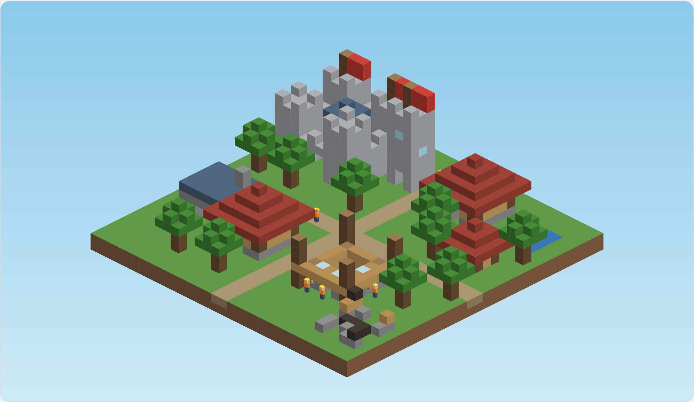

# Focus Town

A mobile app (iOS 17+ and Android 10+, one Flutter codebase) that helps you get back your focus. A small block-style town is built while you stay off your phone. Leave the app mid-session and the builders on that project die, leaving a permanent ruin. Completed buildings grow a persistent town.

## How it works

- Pick a focus session of 10–120 minutes. Length sets the building (hut, house, workshop, tower, castle) and how many workers are at risk.
- Build progress equals real elapsed time and can't be sped up.
- Locking the screen and phone calls are fine. Switching to another app gives you 10 seconds to return, plus one free 60-second pass per session. After that the workers die and the plot becomes a ruin.
- A daily streak, town levels (1 XP per focus minute) and a new plot each focus day drive long-term play.
- Fully offline: no accounts, no analytics, no network.

## Status

Pre-code. The repo currently holds the planning documents only; the Flutter project has not been created yet.

| File | Purpose |
| --- | --- |
| `spec.md` | MVP specification (source of truth) |
| `prompt_plan.md` | 22 ordered, test-driven prompts for building the MVP |
| `todo.md` | Per-step build checklist |
| `CLAUDE.md` | Guidance for Claude Code |

## Planned stack

Flutter, Flame (rendering), Riverpod (state), Drift/SQLite (storage), `flutter_local_notifications`, and native Swift/Kotlin platform channels for lock, app-switch and call detection.

## MVP goal

Prove the builder-death mechanic keeps people off their phones: day-7 retention of at least 20% and a session completion rate of at least 70%.
