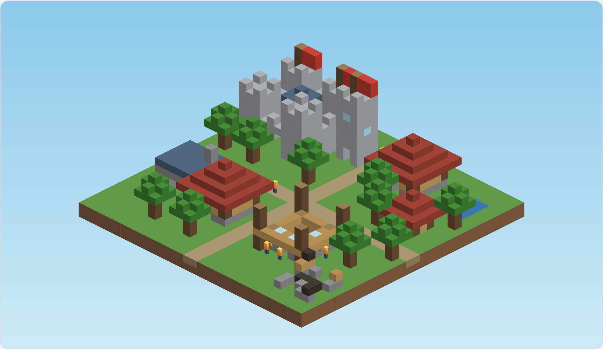
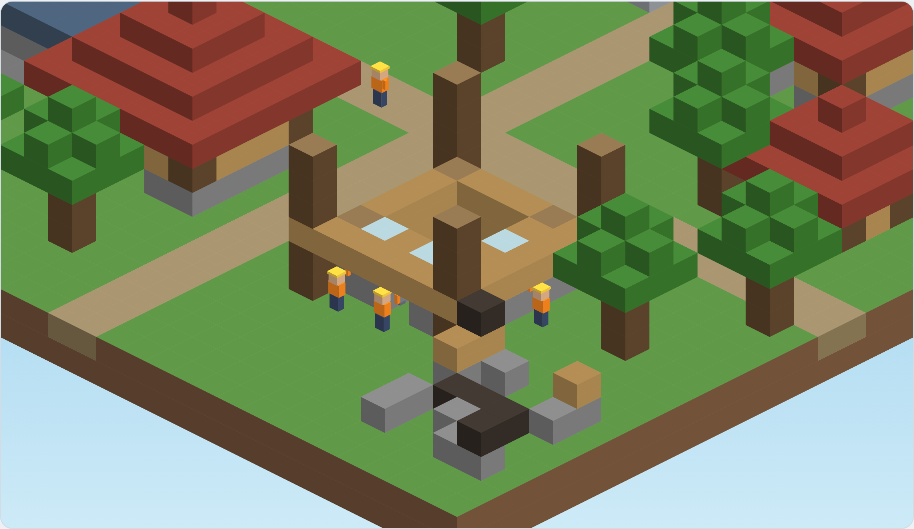

# Focus Town — Build Blueprint and LLM Prompts

A test-driven, step-by-step plan to build the Focus Town MVP from the spec, ending in 22 prompts for a code-generation LLM. Each prompt builds on the last and wires its code into the running app.

- MVP specification: https://claude.ai/artifact/Qx74paD65vuiFNuynNQ394
- Interactive block-style prototype: https://claude.ai/artifact/Ee7RdRToJiXaa2hHeqs263
- Checklist: see `todo.md`

## Visual reference

The target look is the block-style town. Open the interactive prototype to see animation, panning, and zooming.





Top: the whole town, as the renderer should draw it after step 18. Bottom: worker scale (about 1.6 blocks tall), scaffolding, and a ruin.

## How to use these prompts

Run the prompts in order, one per coding session, and don't move on until the step's tests pass and the app still launches on your iPhone.

1. Start every session by pasting **Prompt 0 (shared context)**, then the step's prompt.
2. Let the LLM write the tests first, run them red, then implement until green.
3. Review the diff yourself, run `flutter analyze` and `flutter test`, then commit with the step number in the message (e.g. `step 07: focus controller`).
4. After the platform steps (9–11) and the rendering steps (14–17), do the device check listed in the prompt on your real iPhone.
5. If a step comes out too big, ask the LLM to split it and finish the first half with tests before continuing.

**Rules every prompt assumes**

- Domain code (`lib/domain`) is pure Dart: no Flutter imports, no I/O, time only through the injected `Clock`.
- Every new class is used by the end of its step: by the app, the controller, or a debug screen. No orphaned code.
- No network calls, analytics, or accounts anywhere.
- Tests live beside the layer they cover: `test/domain`, `test/data`, `test/platform`, `test/game`, `test/ui`.

## Blueprint

Five phases, ordered so the riskiest and most testable parts come first and the app is runnable after every step.

| Phase | Goal | Done when |
| --- | --- | --- |
| A. Foundation and rules | Project skeleton, injectable clock, building tiers, session state machine, time-robust elapsed calculation, town rules | All game rules pass unit tests with a fake clock; a debug screen shows live rule output |
| B. Data and controller | Drift database, repository, seeding, and a controller that runs a full session against stored timestamps | A session can be started, interrupted, and resolved from a debug screen, surviving app restarts |
| C. Platform | Lifecycle event stream (fallback, iOS native, Android native) and local notifications | Lock, app switch, and calls are told apart on real devices; warnings fire when leaving |
| D. Block-town rendering | Isometric math, voxel world, building definitions, Flame renderer with cached layer, camera, workers, live construction | The town from the prototype renders from real data at 15–20 fps with pan and zoom |
| E. Screens and release | Session setup, HUD, results, onboarding, error handling, debug tools, accessibility, release builds | Manual device checklist passes; TestFlight build goes to testers |

**Key technical choices (from the spec)**

- Flutter + Flame, Riverpod for state, Drift (SQLite) for storage, flutter_local_notifications.
- Native lifecycle detection through one platform channel per OS, with a lenient Flutter-only fallback.
- Every session outcome is computed from stored timestamps (wall clock + monotonic uptime), never from in-memory timers alone.

## Breaking it down

The final plan is 22 steps of roughly half a day to one day each. It came from three passes.

**Round 1: 10 chunks.** Too big. "Session engine", "platform detection", and "renderer" each hid 3–4 days of work and several unrelated risks.

1. Project setup
2. Game rules
3. Database
4. Controller
5. Platform detection
6. Notifications
7. Renderer
8. Workers and camera
9. Screens
10. Release

**Round 2: 30 steps.** Too small in places. Steps like "add the tier enum" or "add one Drift table" produced no visible progress and no meaningful integration test, and splitting iOS lock detection from iOS call detection doubled the native setup work.

**Round 3: 22 steps (final).** Merged the trivial steps, kept each native platform separate, and split rendering into math → world → paint → camera → workers → live construction. Each step now has one clear risk, its own tests, and a wiring point.

| Step | Name | Main risk it retires | Wired into |
| --- | --- | --- | --- |
| 1 | Project skeleton and clock | Tooling, test setup | App shell + debug screen |
| 2 | Building tiers | Tier math | Debug screen |
| 3 | Elapsed-time calculator | Reboots, clock tampering | Session engine (step 4) |
| 4 | Session state machine | Core rule correctness | Debug screen simulator |
| 5 | Town rules | Workers, plots, queue, recovery | Debug screen simulator |
| 6 | Daily streak, plots, XP | Calendar-day edge cases | Town rules |
| 7 | Database and repository | Persistence, transactions | Debug screen reads stored town |
| 8 | Focus controller | End-to-end session flow | Debug screen buttons |
| 9 | Lifecycle stream and fallback | Event abstraction | Controller |
| 10 | iOS native bridge | Lock vs. switch on iPhone | Lifecycle stream |
| 11 | Android native bridge | Lock vs. switch on Android | Lifecycle stream |
| 12 | Notifications | Warnings when leaving | Controller |
| 13 | Isometric math and voxel world | Projection, face culling, depth order | Renderer (step 15) |
| 14 | Building definitions and town layout | Block lists, stages, plots | World builder |
| 15 | Flame renderer with cached layer | Drawing, performance | Replaces debug screen as home |
| 16 | Camera pan and zoom | Gestures, clamping | Renderer |
| 17 | Workers and frame cap | Animation, battery | Renderer |
| 18 | Live construction | Stages tied to session progress | Renderer + controller |
| 19 | Session setup screen | Picker rules | Home screen |
| 20 | HUD and result screens | Feedback for every outcome | Home screen |
| 21 | Onboarding | First-run flow | App start |
| 22 | Error handling, debug tools, release | Robustness, shipping | Whole app |

**Sizing check:** no step adds more than one new external dependency, every step ends with green tests plus a runnable app, and the two device-dependent steps (10, 11) are isolated so failures there don't block rule or rendering work.

---

## Prompts, phase A: foundation and rules

### Prompt 0: shared context (paste before every step)

```text
You are a senior Flutter engineer helping me build "Focus Town", an iOS + Android app (one Flutter codebase) that helps people stop doomscrolling.

Core mechanic: the user starts a focus session of 10–120 minutes. Small blocky workers construct a building in an isometric block-style (voxel) town while the session runs. If the user switches to another app and doesn't return within 10 seconds (plus one free 60-second pass per session), the assigned workers die and the plot becomes a permanent ruin. Locking the screen or taking a phone call is allowed. Completed buildings grow a persistent town.

Tech: Flutter (Dart 3, null safety), Flame for rendering, Riverpod for state, Drift (SQLite) for local storage, flutter_local_notifications. Fully offline: no network, no accounts, no analytics.

Architecture: lib/domain (pure Dart rules, no Flutter imports, time only via an injected Clock), lib/data (Drift), lib/platform (lifecycle bridge, notifications, clock), lib/game (Flame renderer), lib/ui (widgets), lib/app (providers and wiring). Tests mirror this under test/.

Working rules:
- Test-driven: write failing tests first, then the minimum code to pass, then refactor.
- Small, complete steps: every class you add must be used by the end of the step (by the app, a provider, or the debug screen). No orphaned code.
- Keep existing tests green. Run flutter analyze and flutter test at the end and report results.
- Prefer clear, boring code over clever code. Document public APIs with one-line doc comments.
- Show me the full contents of every new or changed file.
```

### Prompt 1: project skeleton and clock

Sets up the app, folder structure, test tooling, and the injectable clock that every later step depends on.

```text
Step 1 of 22: project skeleton and clock.

Create a new Flutter app named focus_town (iOS 17+, Android 10+ / minSdk 29).

1. Add dependencies: flutter_riverpod. Dev: very_good_analysis (or flutter_lints with strict rules), mocktail.
2. Create folders lib/domain, lib/data, lib/platform, lib/game, lib/ui, lib/app and matching test folders.
3. In lib/domain/clock.dart define an abstract Clock with:
   - DateTime nowWall()   // wall-clock time
   - Duration uptime()    // monotonic time since boot
   Provide SystemClock (uses DateTime.now() and a Stopwatch started at app launch for now; step 10 replaces uptime with a native value) and FakeClock (test helper in lib/domain/testing/fake_clock.dart) with advance(Duration), setWall(DateTime), and simulateReboot() which resets uptime to zero while wall time continues.
4. Tests (test/domain/clock_test.dart): FakeClock advances both clocks together; setWall moves only wall time; simulateReboot resets uptime only.
5. In lib/app/providers.dart add clockProvider (returns SystemClock).
6. Replace the counter app with FocusTownApp (MaterialApp) whose home is DebugScreen (lib/ui/debug_screen.dart). DebugScreen shows a title "Focus Town debug" and the current wall time and uptime read from clockProvider, refreshed every second.
7. Widget test: DebugScreen renders the title and a time value when clockProvider is overridden with FakeClock.

Done when: flutter test is green, flutter analyze is clean, and the app launches showing the debug screen.
```

### Prompt 2: building tiers

Encodes the five tiers so every later rule uses one source of truth.

```text
Step 2 of 22: building tiers.

In lib/domain/building_tier.dart:
1. enum BuildingTier { hut, house, workshop, tower, castle } with fields: minMinutes, maxMinutes, workersAtRisk, workersAddedOnSuccess.
   - hut: 10–20 min, risk 1, adds 1
   - house: 21–40 min, risk 2, adds 2
   - workshop: 41–60 min, risk 3, adds 0
   - tower: 61–90 min, risk 5, adds 0
   - castle: 91–120 min, risk 8, adds 0
2. static BuildingTier forMinutes(int minutes): throws ArgumentError if minutes < 10, > 120, or not a multiple of 5.
3. static List<int> validDurations(): 10, 15, ... 120.
4. static BuildingTier? largestAffordable(int workers): the biggest tier whose workersAtRisk <= workers, or null.

Tests (test/domain/building_tier_test.dart): every boundary (10, 20, 25, 40, 45, 60, 65, 90, 95, 120), invalid inputs, validDurations length 23, largestAffordable for 0, 1, 2, 3, 4, 5, 8, 20 workers.

Wiring: on DebugScreen add a slider over validDurations showing the chosen minutes, the tier name, and workers at risk.

Done when: tests green, slider works on device.
```

### Prompt 3: elapsed-time calculator

Isolates the trickiest time logic before the state machine depends on it.

```text
Step 3 of 22: elapsed-time calculator.

In lib/domain/time_stamp.dart define an immutable TimeStamp { DateTime wall; Duration uptime; } with a factory TimeStamp.now(Clock clock).

In lib/domain/elapsed.dart implement Duration elapsedBetween(TimeStamp from, TimeStamp to) with these rules:
1. Normal case (to.uptime >= from.uptime): return to.uptime - from.uptime. Uptime is trusted over wall time.
2. Reboot happened (to.uptime < from.uptime): return to.wall - from.wall, clamped to >= 0.
3. Never return a negative duration.

Also implement bool wallClockTampered(TimeStamp from, TimeStamp to): true when uptime did not reset and |wallDelta - uptimeDelta| > 2 minutes.

Tests (test/domain/elapsed_test.dart) using FakeClock:
- 30 minutes passes normally
- wall clock moved forward 2 hours mid-way: elapsed is still the real 30 minutes, tampered is true
- wall clock moved backward: elapsed unaffected
- reboot after 10 minutes, 5 more minutes of wall time: elapsed 15 minutes
- reboot with wall clock moved backward: elapsed 0, not negative

Wiring: on DebugScreen, show "elapsed since app start" computed with elapsedBetween from a TimeStamp captured when the screen first builds.

Done when: tests green.
```

### Prompt 4: session state machine

The heart of the product. Pure logic, exhaustively tested, driven by events and timestamps.

```text
Step 4 of 22: session state machine.

In lib/domain/session.dart create an immutable Session: id (String), plannedMinutes, tier, workersAssigned, state (enum SessionState { running, away, completed, failed }), startedAt (TimeStamp), leftAt (TimeStamp?), awayTotal (Duration), passUsed (bool), outcomeReason (enum OutcomeReason? { completed, leftTooLong, abandoned }).

In lib/domain/session_engine.dart create SessionEngine with pure functions that return a new Session:
- start({id, minutes, workersAvailable, now}): validates minutes via BuildingTier.forMinutes; throws StateError if workersAvailable < tier.workersAtRisk.
- onLocked(session, now) / onCallStarted(session, now): no state change (allowed). Return session unchanged.
- onBackgroundedUnlocked(session, now): running -> away, records leftAt.
- onForegrounded(session, now): resolves an away session:
    away time = elapsedBetween(leftAt, now)
    <= 10s: back to running, awayTotal += away time
    > 10s and <= 70s and !passUsed: running, passUsed = true, awayTotal += away time
    otherwise: failed with leftTooLong
- abandon(session, now): failed with abandoned.
- resolve(session, now): the single function called on every tick and app launch. If away, apply the same away rules as onForegrounded using now (an away session past its limit fails even if the app never returns to foreground). If running and elapsedBetween(startedAt, now) >= plannedMinutes, mark completed. Completion time counts the whole session wall span; time spent away within the allowed limits still counts.
- progress(session, now): 0.0–1.0.

Constants: kWarningWindow = 10s, kPassWindow = 60s.

Tests (test/domain/session_engine_test.dart) with FakeClock: happy path completion; lock for 5 minutes (no effect); away 5s; away 30s uses pass; second away of 30s in the same session fails; away 90s fails; resolve() while still away past 70s fails without onForegrounded; completion exactly at planned time; abandon; start with too few workers throws; progress at 0, 50%, 100%; reboot during away (via elapsedBetween) fails correctly.

Wiring: add a "Session simulator" panel to DebugScreen that uses a local FakeClock: buttons Start (uses the slider minutes), +1 min, Leave, Return after 5s / 30s / 90s, Lock, Abandon. Show state, progress, passUsed, and outcome.

Done when: tests green and the simulator behaves per the rules.
```

### Prompt 5: town rules

Workers, plots, the placement queue, and recovery mode, applied to session outcomes.

```text
Step 5 of 22: town rules.

In lib/domain/town.dart create immutable TownState: workers (int), plotsUnlocked (int), buildings (List<TownBuilding>), queue (List<BuildingTier>), inRecoveryMode (bool). TownBuilding: id, tier, status (enum BuildingStatus { complete, ruin }), plotIndex.
TownState.initial(): workers 3, plotsUnlocked 6, buildings = [house on plot 0, complete], queue empty, recovery false.

In lib/domain/town_rules.dart create TownRules with pure functions:
- int? nextFreePlot(TownState): lowest plot index < plotsUnlocked not occupied by a building, else null.
- TownState applyCompleted(TownState, Session): add tier.workersAddedOnSuccess workers (assigned workers return alive). Place the building on nextFreePlot, or append its tier to queue if none.
- TownState applyFailed(TownState, Session): subtract workersAssigned; if a plot is free, place a ruin there (a ruin occupies a plot); if not, nothing is placed.
- Recovery: after any change, if workers == 0 set inRecoveryMode = true. While in recovery, start is allowed with 0 workers but only for hut duration (10–20 min) and the wanderer is not counted or killed: applyFailed in recovery subtracts nothing. Exit recovery when workers >= 3.
- bool canStart(TownState, int minutes): true if workers >= tier.workersAtRisk, or recovery and tier == hut.
- TownState placeQueued(TownState): while queue not empty and a plot is free, place the oldest queued building.

Update SessionEngine.start to accept workersAvailable from TownRules (recovery allows a hut with 0 workers; workersAssigned is 0 in that case).

Tests (test/domain/town_rules_test.dart): initial state; hut success adds 1 worker; castle success adds 0 and places on next plot; failure removes workers and leaves ruin; filling all 6 plots then succeeding queues; placeQueued after plotsUnlocked increases; dropping to 0 workers enters recovery; recovery hut failure costs nothing; 3 recovery huts exit recovery; canStart for every tier at several worker counts.

Wiring: the DebugScreen simulator now owns a TownState. Completing or failing a simulated session applies the rules; show workers, plots used/unlocked, queue length, recovery flag, and a list of buildings. Disable slider values that canStart rejects.

Done when: tests green and the simulator updates the town correctly.
```

### Prompt 6: daily streak, plots, and XP

Calendar-day logic, kept separate because date edge cases are a classic bug source.

```text
Step 6 of 22: daily streak, daily plots, and town level.

Extend TownState with: xp (int), streakCount (int), lastStreakDate (LocalDate?), lastPlotGrantDate (LocalDate?). Add a tiny LocalDate value class in lib/domain/local_date.dart (year, month, day; from DateTime in local time; daysBetween).

In lib/domain/progression.dart:
1. TownState onSessionCompleted(TownState, Session, DateTime completedAtLocal):
   - xp += plannedMinutes
   - streak: same day as lastStreakDate -> unchanged; exactly 1 day after -> +1; otherwise -> 1. Set lastStreakDate.
   - daily plot: if lastPlotGrantDate != today, plotsUnlocked += 1 and set lastPlotGrantDate; then call placeQueued.
2. int currentStreak(TownState, LocalDate today): returns 0 if today is more than 1 day after lastStreakDate (streak broken but not yet reset), else streakCount.
3. enum TownLevel { camp(0), village(300), town(1500), city(6000), metropolis(15000) } with levelFor(xp) and progressToNext(xp) 0.0–1.0.
4. Failed sessions change none of these.

Wire onSessionCompleted into the same place applyCompleted is called (completion = applyCompleted then onSessionCompleted).

Tests (test/domain/progression_test.dart): two sessions same day (streak 1, one plot); consecutive days (streak 2, two plots); a gap day resets to 1; currentStreak shows 0 after a missed day; queue drains when a daily plot arrives; xp thresholds for every level boundary; progressToNext midway; month and year boundaries (Jan 31 -> Feb 1, Dec 31 -> Jan 1).

Wiring: DebugScreen simulator gets a "+1 day" button (advances FakeClock by 24h) and shows streak, level name, and level progress.

Done when: tests green. Phase A is complete: all core rules exist as pure, tested Dart.
```

---

## Prompts, phases B and C: data, controller, platform

### Prompt 7: database and repository

Persists the town and sessions so everything survives app kills.

```text
Step 7 of 22: database and repository.

Add drift, drift_flutter (or sqlite3_flutter_libs + path_provider), and dev deps drift_dev, build_runner.

1. lib/data/database.dart: Drift database with tables:
   - towns (single row): id, workerCount, plotsUnlocked, xp, streakCount, lastStreakDate (text yyyy-mm-dd, nullable), lastPlotGrantDate (nullable), inRecoveryMode, onboardingDone, createdAt
   - buildings: id, tier, status (complete/ruin/queued), plotIndex (nullable), sessionId (nullable), completedAt
   - sessions: id, plannedMinutes, tier, workersAssigned, state, startedAtWall, startedAtUptimeMs, leftAtWall, leftAtUptimeMs, awayTotalMs, passUsed, outcomeReason, resolvedAt
   schemaVersion = 1.
2. lib/data/town_repository.dart: TownRepository with
   - Future<TownState> loadOrCreate(): creates TownState.initial() on first run (starter house on plot 0).
   - Future<Session?> activeSession(): state running or away.
   - Future<void> saveSessionStarted(TownState, Session)
   - Future<void> saveSessionUpdated(Session)
   - Future<void> saveSessionResolved(TownState, Session): writes the session and the full new town state (town row + buildings incl. queued) in ONE transaction.
   Map between Drift rows and domain types in a separate mapper file; domain stays Drift-free.
3. Tests (test/data/town_repository_test.dart) using an in-memory NativeDatabase: first run seeds initial town; round-trip of every TownState field; active session found after save; resolved save is atomic (simulate an exception mid-transaction and verify nothing changed); queued buildings round-trip.
4. Wiring: databaseProvider and townRepositoryProvider in lib/app/providers.dart. DebugScreen gets a "Stored town" card showing workers, plots, xp, streak, and building count loaded from the repository.

Done when: tests green; data persists across an app restart on device.
```

### Prompt 8: focus controller

Joins rules, clock, and storage into one place the UI and platform events talk to. The debug simulator switches from fake data to the real database.

```text
Step 8 of 22: focus controller.

In lib/app/focus_controller.dart create FocusController (a Riverpod Notifier/AsyncNotifier) holding FocusState { TownState town; Session? active; SessionResult? lastResult; }.
SessionResult: outcome (completed/failed/queued), tier, workersLost, workersGained, newStreak, plotGranted.

Methods (all use injected Clock, SessionEngine, TownRules, progression, TownRepository):
- init(): load town; if an active session exists, resolve(now) it and persist; set lastResult if it finished while the app was closed.
- start(minutes): validate with TownRules.canStart, create session, persist, update state.
- onLocked(), onCallStarted(), onBackgroundedUnlocked(), onForegrounded(): forward to SessionEngine, persist the updated session, and if the session finished, apply town rules and save atomically.
- tick(): call resolve(now); completes or fails the session when due. Called every second while a session is active.
- abandon()
- clearResult()

Tests (test/app/focus_controller_test.dart) with FakeClock + in-memory DB via ProviderContainer overrides: start -> tick to completion -> town updated and persisted; leave 90s -> failure; leave 30s -> pass; app 'killed' (new container, same DB) with an away session past its limit -> init resolves as failure with lastResult set; completion while killed -> resolved as completed on init; cannot start without workers; recovery flow end-to-end.

Wiring: replace the DebugScreen simulator's local logic with FocusController (real DB, real SystemClock). Keep simulated buttons for Leave/Return/Lock that call the controller methods directly, plus a 1-second Timer that calls tick() while a session is active. Show lastResult in a dialog and call clearResult on dismiss.

Done when: tests green; on device you can start a real 10-minute session from the debug screen, force-quit, reopen, and see it resolved correctly.
```

### Prompt 9: lifecycle event stream and fallback

Defines the platform abstraction and a lenient Flutter-only implementation, so the app works before native code exists.

```text
Step 9 of 22: lifecycle event stream and Flutter fallback.

1. lib/platform/lifecycle_events.dart: sealed class LifecycleEvent { locked, unlocked, backgrounded, foregrounded, callStarted, callEnded } each carrying a TimeStamp. abstract LifecycleSource { Stream<LifecycleEvent> get events; bool get isNative; Future<void> dispose(); }.
2. lib/platform/fallback_lifecycle_source.dart: uses WidgetsBindingObserver / AppLifecycleState. Because Flutter alone cannot tell a lock from an app switch, map paused -> locked (lenient: never punishes) and resumed -> unlocked + foregrounded. isNative = false.
3. lib/platform/lifecycle_router.dart: LifecycleRouter subscribes to a LifecycleSource and calls FocusController:
   - locked -> onLocked
   - callStarted -> onCallStarted (and remember inCall=true; backgrounded during a call is ignored)
   - backgrounded (not locked, not in call) -> onBackgroundedUnlocked
   - foregrounded -> onForegrounded
   Handle ordering: if backgrounded arrives and a locked event arrives within 500 ms, treat it as locked (undo the away by calling onLocked then onForegrounded with no penalty). Implement this with a short pending window driven by the Clock, not by Future.delayed, so it is testable.
4. FakeLifecycleSource for tests (a StreamController you push events into).
5. Tests (test/platform/lifecycle_router_test.dart): each mapping; backgrounded then locked within 500 ms = no penalty; backgrounded during a call ignored; events with no active session are no-ops.

Wiring: lifecycleSourceProvider (fallback for now) and LifecycleRouter started in FocusTownApp. Add an "Event log" panel to DebugScreen showing the last 20 lifecycle events with timestamps and source type (native/fallback).

Done when: tests green; on device, backgrounding the app appears in the event log.
```

### Prompt 10: iOS native bridge

The riskiest platform piece. Built after the abstraction so the rest of the app doesn't change.

```text
Step 10 of 22: iOS native lifecycle bridge.

1. In ios/Runner, add a Swift FocusLifecyclePlugin registered in AppDelegate that exposes:
   - EventChannel "focus/lifecycle/events" emitting maps {type, wallMs, uptimeMs}
   - MethodChannel "focus/lifecycle" with method uptimeMs (returns ProcessInfo.processInfo.systemUptime in ms; this is monotonic since boot)
2. Event sources:
   - UIApplication.protectedDataWillBecomeUnavailable -> locked; protectedDataDidBecomeAvailable -> unlocked (note: requires a passcode on the device; document this)
   - UIApplication.didEnterBackground -> backgrounded; willEnterForeground -> foregrounded
   - CXCallObserver delegate: call connected/ringing -> callStarted; ended -> callEnded
   Emit locked BEFORE backgrounded when both fire for a lock, by checking UIApplication.shared.isProtectedDataAvailable at didEnterBackground time and, if unavailable, sending locked first.
3. Dart: lib/platform/native_lifecycle_source.dart implements LifecycleSource over these channels (isNative = true). lifecycleSourceProvider picks native on iOS when the channel responds to a ping, else fallback.
4. Replace SystemClock.uptime() on iOS with the native uptimeMs (cache an offset at launch and use a Stopwatch between calls to avoid channel calls every frame).
5. Tests: Dart-side unit tests for NativeLifecycleSource parsing using a mocked EventChannel (TestDefaultBinaryMessenger); malformed events are ignored and logged.
6. Manual device test (write the checklist into docs/device_tests.md and run it on the iPhone): lock 1 min -> event log shows locked/backgrounded, no penalty; switch apps -> backgrounded only, warning path; take a call -> callStarted, no penalty; Control Center pull-down -> no events.

Wiring: native source is used automatically on iOS; the event log shows "native".

Done when: Dart tests green and every iOS manual check passes.
```

### Prompt 11: Android native bridge

Same contract as iOS, so only the Kotlin side and the device check are new.

```text
Step 11 of 22: Android native lifecycle bridge.

1. In android/app, add a Kotlin FocusLifecyclePlugin registered in MainActivity with the same channels as iOS: EventChannel "focus/lifecycle/events" and MethodChannel "focus/lifecycle" (uptimeMs via SystemClock.elapsedRealtime(), which counts deep sleep and is monotonic since boot).
2. Event sources:
   - Activity onStop -> backgrounded (onPause alone also fires for the notification shade, so use onStop); onStart -> foregrounded
   - BroadcastReceiver (registered dynamically) for ACTION_SCREEN_OFF -> locked and ACTION_USER_PRESENT -> unlocked
   - When onStop fires, check KeyguardManager.isKeyguardLocked or PowerManager.isInteractive == false; if locked/off, emit locked before backgrounded
   - Calls: TelephonyManager with TelephonyCallback (API 31+) or PhoneStateListener (API 29–30) for CALL_STATE_RINGING/OFFHOOK -> callStarted, IDLE -> callEnded. If this requires READ_PHONE_STATE on the device's API level, request it at onboarding later (step 21) and treat calls as unknown (no exemption beyond lock) until granted; document this.
3. Dart: NativeLifecycleSource works unchanged; lifecycleSourceProvider now picks native on Android too.
4. Tests: reuse the Dart parsing tests; add a test that the provider falls back when the channel is missing.
5. Manual device test on a Samsung or Xiaomi phone (append to docs/device_tests.md): screen off 1 min; app switch; notification shade pull-down (must NOT be backgrounded); phone call; recent-apps screen; split screen.

Wiring: event log shows "native" on Android.

Done when: tests green and all Android manual checks pass.
```

### Prompt 12: notifications

Warnings when the user leaves, so the 10-second window is actually useful.

```text
Step 12 of 22: local notifications.

Add flutter_local_notifications (and timezone if required by the package version).

1. lib/platform/notifier.dart: abstract Notifier { Future<bool> requestPermission(); Future<bool> hasPermission(); Future<void> scheduleAwayWarnings({required bool passAvailable}); Future<void> cancelAwayWarnings(); }
   Implementation LocalNotifier:
   - immediately: "Come back! Your builders stop in 10 seconds."
   - if passAvailable, at +10s: "Emergency pass used. You have 60 seconds."
   Use fixed notification ids so cancel is reliable. Android: create a high-importance channel "focus_warnings".
2. FakeNotifier for tests recording calls.
3. FocusController: on onBackgroundedUnlocked call scheduleAwayWarnings(passAvailable: !session.passUsed); on onForegrounded, onLocked, completion, failure, and abandon call cancelAwayWarnings. Notification failures are caught and logged; they never affect session outcome.
4. Tests (test/app/focus_controller_notifications_test.dart): schedule on leave with/without pass; cancel on return; cancel on lock; exceptions from the notifier do not break the session.
5. Wiring: notifierProvider; DebugScreen adds a "Request notification permission" button and shows permission status. (The real permission prompt moves to onboarding in step 21.)

Done when: tests green; on the iPhone, switching apps during a session shows the warning within a second, and returning cancels the second notification.
```

---

## Prompts, phase D: block-town rendering

These steps port the block-style prototype (https://claude.ai/artifact/Ee7RdRToJiXaa2hHeqs263) into Flame, driven by real town data. Give the LLM the prototype's HTML source as reference for step 13 onward.

### Prompt 13: isometric math and voxel world

Pure geometry first, so rendering bugs can be caught by unit tests instead of by eye.

```text
Step 13 of 22: isometric math and voxel world (pure Dart, in lib/game/world/, no Flame imports yet).

Reference: the attached prototype HTML (focus-town-voxel.html). Match its projection and face rules.

1. iso.dart: Offset-free projection using a small Vec2 type. project(x, y, z, tile, origin) => screen point where sx = ox + (x - y) * tile, sy = oy + (x + y) * tile / 2 - z * tile. Also unproject for ground plane (z = 0), needed later for the camera.
2. block_material.dart: BlockMaterial with top, sideX, sideY colors plus 4 texture variants per face (precomputed). Palette from the prototype: grass, dirt, path, plank, log, cobble, stone, roof, slate, glass, leaves, water, wool, char.
3. voxel_world.dart: VoxelWorld with set/get/remove(x, y, z), fill(box), ring(...), visibleFaces(x, y, z) bitmask (top if no block above, +x if none at x+1, +y if none at y+1), and List<VisibleBlock> sortedVisible() ordered by depth x + y + z (stable tie-break by z, then x).
4. Tests (test/game/voxel_world_test.dart): projection of known points; unproject(project(p)) round-trips on the ground plane; a single block has 3 visible faces; a block fully surrounded has none; stacking hides the lower top face; depth order puts back blocks before front blocks; fill and ring produce expected counts.

Wiring: add a "World stats" line to DebugScreen that builds a VoxelWorld with a 32x32 ground and shows the visible block count (proves the module is integrated; the renderer uses it in step 15).

Done when: tests green.
```

### Prompt 14: building definitions and town layout

Turns TownState into blocks: plots, roads, scenery, every tier at every construction stage, and ruins.

```text
Step 14 of 22: building definitions and town layout (lib/game/world/).

1. plot_layout.dart: a fixed, deterministic list of plots along a crossing-roads grid on a 32x32 map (as in the prototype: roads at x=15–16 and y=15–16). Each plot has index, origin (x, y), footprint 7x7 (buildings up to 5x5 plus margin). Order plots so index 0–5 are nearest the crossing and later plots spiral outward. Provide at least 40 plots.
2. building_defs.dart: void buildTier(VoxelWorld w, BuildingTier t, Point origin, {int stage, bool scaffold}) with stages 1..maxStage per tier (e.g. house: foundation, walls, windows, roof layers, peak = 7 stages). Hut, house, workshop, tower, castle shapes follow the prototype (castle footprint may exceed 5x5: give castles a double plot by reserving the next plot, or shrink the castle to fit 7x7; choose shrink-to-fit and document it). Also buildRuin, buildTree, buildScenery (pond, trees on non-plot tiles, deterministic from a seed).
3. int maxStage(BuildingTier) and int stageForProgress(BuildingTier, double progress).
4. town_world_builder.dart: VoxelWorld buildTownWorld(TownState town, {Session? active, double progress}): ground, roads, unlocked plots marked with a subtle path border, locked plots as plain grass, buildings and ruins on their plots, the active session's building at stageForProgress on nextFreePlot (or a temporary site beside the road if all plots are full).
5. Tests (test/game/town_world_test.dart): every tier's final stage fits its plot footprint; block count is non-decreasing across stages; stageForProgress(0)=1 and (1.0)=max; a TownState with 3 buildings produces blocks on exactly those plots; ruins appear for ruin status; scenery is deterministic for the same seed; no scenery overlaps roads or unlocked plots.

Wiring: DebugScreen "World stats" now builds the world from the controller's real TownState and shows block counts per building.

Done when: tests green.
```

### Prompt 15: Flame renderer with cached static layer

The town becomes visible and replaces the debug screen as the home screen.

```text
Step 15 of 22: Flame renderer.

Add flame.

1. lib/game/town_game.dart: TownGame extends FlameGame. Holds the current VoxelWorld and renders sortedVisible() blocks as 3 textured faces each (base quad + 2x2 texture variants when tile >= 9 px, plain quads when smaller), exactly like the prototype.
2. Performance: render the static town (everything except the active site, done in step 18, and workers, step 17) once into a ui.Picture/ui.Image via PictureRecorder at the current camera transform, and draw that image each frame. Re-record only when the town changes or the camera zoom changes; for pans, translate the cached image and re-record when panning more than 25% of the viewport.
3. Viewport culling when recording: skip blocks whose projected bounds are off-screen.
4. Sky: vertical gradient background matching the prototype.
5. lib/ui/home_screen.dart: HomeScreen with GameWidget(TownGame) full screen. TownGame listens to focusControllerProvider (via a small bridge that passes TownState changes into the game) and rebuilds the world on change.
6. Tests: golden test (test/game/town_render_golden_test.dart) rendering TownState.initial() and a 5-building town at a fixed size and camera; a unit test that the cache re-records only on town change or zoom change (count recordings with a spy).

Wiring: HomeScreen becomes the app's home. DebugScreen stays reachable from a long-press on the top-left corner (debug builds only).

Done when: goldens pass and the real town shows on the iPhone with smooth scrolling.
```

### Prompt 16: camera pan and zoom

Lets users walk through their town, as required by FR-11.

```text
Step 16 of 22: camera.

1. lib/game/camera/town_camera.dart (pure Dart): state {tile, origin}; fitToTown(viewSize, mapSize); panBy(delta); zoomAt(focalPoint, factor) keeping the world point under the focal point fixed; clamp tile between fitTile*0.7 and 64 px; clamp origin so at least 30% of the map stays on screen; focusOn(worldPoint) for jumping to the active site.
2. Gestures in TownGame: drag to pan, pinch to zoom (ScaleDetector), mouse wheel zoom on desktop/simulator, double-tap to zoom in 1.5x at the tap point.
3. When a session starts, animate focusOn(active site) over 400 ms (ease-out). A "recenter" button on HomeScreen calls fitToTown.
4. Tests (test/game/town_camera_test.dart): zoomAt keeps the focal world point fixed; clamps hold at both ends; fitToTown shows the whole map; panBy cannot push the map fully off-screen; focusOn centers the target.

Wiring: HomeScreen gets the recenter button; FocusController.start triggers focusOn via the game bridge.

Done when: tests green; pan, pinch, and double-tap feel right on the iPhone.
```

### Prompt 17: workers and frame cap

Adds life to the town while protecting battery (NFR-3, NFR-4).

```text
Step 17 of 22: workers, animation loop, and frame cap.

1. lib/game/workers/worker_model.dart (pure Dart): a worker is 4–6 boxes (legs, torso, head, helmet, arm, tool) with sizes from the prototype (about 1.6 blocks tall). Poses: idle, hammerUp, hammerDown, walk1, walk2, dead (lying flat, helmet beside). Function List<Box> boxesFor(Worker w, Pose p) returning boxes with fractional positions and colors.
2. Assignment: site workers = session.workersAssigned, positioned around the active site's plot facing it; spare workers (town.workers - assigned) up to 4 walk back and forth along roads (simple ping-pong on fixed road lines, no pathfinding).
3. Drawing: workers are drawn each frame on top of the cached static layer, but must be correctly occluded. Merge worker boxes into the depth order only for blocks near them: for each worker, redraw the static blocks within a 3-block radius that sort after the worker. Document this approach and its limits.
4. Frame cap: lib/game/frame_limiter.dart limits updates/renders to 15 fps normally, 10 fps when the OS low-power mode is on (read via a platform method added to the existing channel: lowPowerMode), and 0 when the app is not visible or the screen is locked (pause the GameWidget).
5. Reduced motion (MediaQuery.disableAnimations): workers stay in idle pose; no walking.
6. Tests: boxesFor height ~1.6 and all poses non-empty; FrameLimiter allows the right number of frames per second with a fake clock; low power and hidden states; worker count logic for assigned vs. spare.

Wiring: TownGame renders workers from FocusState. The DebugScreen shows measured fps.

Done when: tests green; Instruments/profiler shows ~15 fps and near-zero GPU when locked.
```

### Prompt 18: live construction

Connects session progress to what users see: the building grows, then succeeds or collapses.

```text
Step 18 of 22: live construction.

1. The active site is rendered as a separate dynamic layer (not in the static cache): building at stageForProgress(tier, progress) with log scaffolding until the last stage. Re-record the dynamic layer only when the stage changes.
2. Transitions driven by FocusController results:
   - completed: scaffolding removed, a short 1-second celebration (dust particles in block colors, then fade), building merged into the static town, workers walk back to roads
   - failed: workers switch to dead pose, site becomes a ruin with a smoke particle effect for 3 seconds
   - queued (no free plot): building appears briefly as a floating outline over the road with a "ready to place" label, then disappears into the queue
3. Progress comes from SessionEngine.progress(session, clock.now) computed in update(), not stored state.
4. Tests: stage changes at the right progress thresholds for each tier; dynamic layer re-record count equals number of stage changes; golden tests for mid-construction (house stage 4) and failed (ruin + dead workers) states.

Wiring: everything runs from the real FocusController; start a session from the DebugScreen and watch the HomeScreen build it.

Done when: tests green; a 10-minute session visibly builds a hut on the iPhone. Phase D is complete.
```

---

## Prompts, phase E: screens and release

### Prompt 19: session setup screen

The real way to start a session, replacing the debug buttons for users.

```text
Step 19 of 22: session setup screen.

1. lib/ui/session_setup_sheet.dart: a bottom sheet opened from a large "Start focus" button on HomeScreen.
   - Duration picker over BuildingTier.validDurations (wheel or slider with 5-minute steps), default 25 min, last used value remembered in the towns table (add column lastDurationMinutes; this is schema v2, add a tested migration).
   - Live preview: tier name, small block preview icon (render the tier's final stage with the existing renderer into an image), "risks N workers" and, for huts and houses, "+N workers if you finish".
   - Durations rejected by TownRules.canStart are disabled with a reason line ("Needs 5 workers, you have 3").
   - In recovery mode, only hut durations are enabled and a banner explains the Last Builder.
   - Start button calls FocusController.start and closes the sheet.
2. Widget tests (test/ui/session_setup_sheet_test.dart): default duration; preview updates with the picker; disabled durations with too few workers; recovery mode limits; start calls the controller with the chosen minutes; migration test v1 -> v2 keeps data.

Wiring: HomeScreen shows the Start focus button when no session is active.

Done when: tests green; a session can be started from the home screen without the debug screen.
```

### Prompt 20: HUD and result screens

Gives clear feedback for every state and outcome.

```text
Step 20 of 22: HUD and result screens.

1. lib/ui/hud.dart, always visible on HomeScreen: streak flame + count (currentStreak), town level name + progress bar, workers count, plots used/unlocked, queue badge when queue is not empty.
2. During a session: large countdown timer, tier name, progress bar, a "Lock your phone and put it face down" hint for the first 3 sessions, and an Abandon button behind a confirmation dialog ("Your N builders will stop and the site becomes a ruin").
3. lib/ui/result_dialogs.dart driven by FocusState.lastResult:
   - completed: tier built, workers gained, XP gained, streak, "new plot unlocked" if granted, level-up banner if the level changed
   - completed but queued: "Ready to place" explanation
   - failed: workers lost, how long they were away; if recovery started, introduce the Last Builder
   - recovery ended: "Your town is back on its feet"
   Dismiss calls clearResult.
4. Copy uses plain language and active voice; no emoji.
5. Widget tests for each HUD state and each result dialog variant; abandon confirmation flow; queue badge visibility.

Wiring: all shown from real FocusController state. Remove the session buttons from DebugScreen that are now redundant (keep Leave/Return simulators for testing).

Done when: tests green; full session loop works on the iPhone with no debug screen.
```

### Prompt 21: onboarding

The first 30 seconds: three screens, then the first real session as the tutorial.

```text
Step 21 of 22: onboarding.

1. lib/ui/onboarding/: three pages with a page indicator, each with a small looping render from the real TownGame (not static images):
   - "Your town grows while you focus." (town with working builders)
   - "Leave the app, and your builders stop." (a site turning into a ruin)
   - "Start your first build." with a preselected 10-minute hut and a Start button.
2. On the third page, request notification permission with one line explaining why ("So we can warn you before your builders stop"). On Android, if call detection needs READ_PHONE_STATE (see step 11), request it here with its own explanation; if denied, continue.
3. Pressing Start: set towns.onboardingDone = true, start the 10-minute hut session, go to HomeScreen.
4. In-context tips (shown once each, stored as flags in the towns table, schema v3 with migration): first time leaving the app (pass explanation on return), first completed hut/house (worker growth), first recovery mode.
5. If notification permission was denied, show a one-time note on HomeScreen that warnings won't appear.
6. Tests: onboarding shows only when onboardingDone is false; permission request called once; Start begins a 10-minute session; tips appear once each; migration v2 -> v3.

Wiring: FocusTownApp routes to onboarding or HomeScreen based on stored state.

Done when: tests green; a fresh install walks through onboarding into a running session in under 30 seconds.
```

### Prompt 22: error handling, debug tools, and release

Hardens every failure path from the spec, then ships the beta.

```text
Step 22 of 22: error handling, debug tools, accessibility, and release.

1. Error handling (follow the spec's Error handling table):
   - DB write failure: retry once; on second failure show "Couldn't save your session. Try again." and never start a session that wasn't saved.
   - DB open/migration failure: before every migration copy the DB file to focus_town.backup.sqlite; on failure restore it; if no backup, start a fresh town and show "We couldn't load your town and started a new one."
   - Native bridge missing or silent for the first session: fall back to FallbackLifecycleSource (lenient).
   - Render error or sustained fps below 5: show the last cached town image as a static picture; the timer keeps running.
   - Wall-clock tampering detected: trust uptime (already in elapsedBetween); log it.
2. lib/platform/local_log.dart: ring buffer of the last 200 log lines persisted to a file; all caught errors go here.
3. DebugScreen (debug builds and a hidden 7-tap on the level badge in release): log viewer with share/export, beta stats (sessions started, completed, failed, completion rate, days active, first-open date for day-7 retention), and the existing simulators.
4. Accessibility: semantics labels on all buttons and HUD values ("Streak, 4 days"), Dynamic Type in menus, a text summary of the town for screen readers ("Your town has 6 buildings and 7 workers"), reduced motion respected.
5. Release: app icon (a small block house), splash, bundle id, versioning, iOS release signing, Android release keystore (document storing it safely), privacy manifest (iOS PrivacyInfo.xcprivacy declaring no tracking/no data collected), store data-safety answers: no data collected.
6. Final integration test (integration_test/full_flow_test.dart) with an injected fast FakeClock: onboarding -> start hut -> leave 5s -> return -> complete -> start house -> leave 90s -> fail -> next day -> streak and plot granted.
7. Run the full manual device checklist (docs/device_tests.md) on the iPhone and an Android phone.

Wiring: everything ships in the release build; the DebugScreen is hidden from normal users.

Done when: all tests green, manual checklist passes on both platforms, and a TestFlight build is uploaded.
```

### After step 22

The MVP is complete. Before adding any v2 feature (coins, famous buildings, cleanup sessions), check the beta exit criteria from the spec: day-7 retention of at least 20%, completion rate of at least 70%, and no data-loss bugs.
