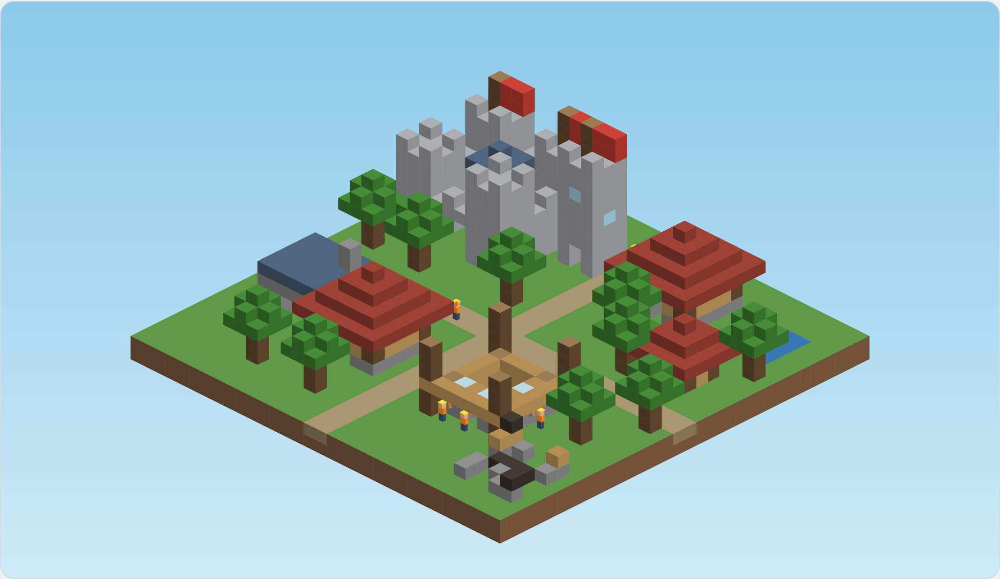
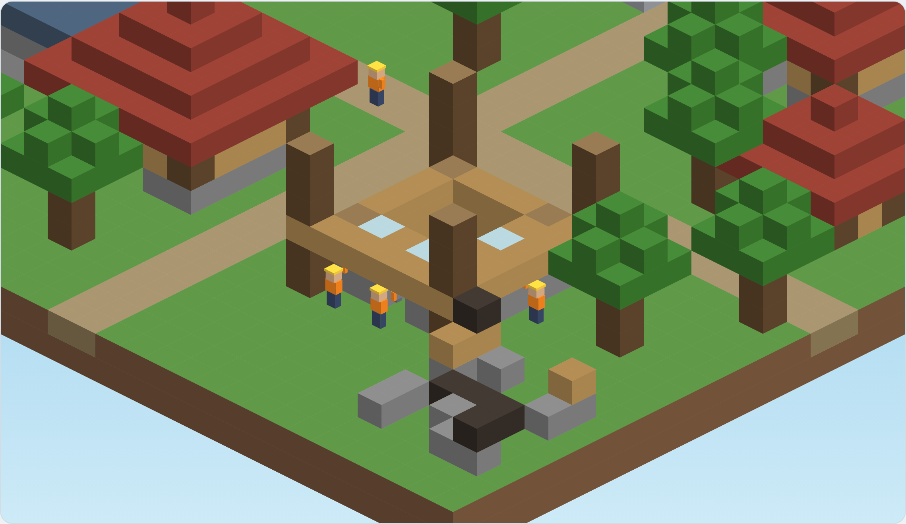

# Focus Town — MVP Specification

Nov 8, 2026 · @Shashank Kumar Hayyal

## Overview

Focus Town is a mobile app for iOS and Android where a small block-style town is built while the user stays off their phone. Leaving the app mid-session kills the builders on that project and leaves a ruin. Completed buildings grow a persistent town.

- **Audience:** anyone trying to cut doomscrolling (students, developers, general users).
- **MVP goal:** prove the builder-death mechanic keeps people off their phones and brings them back daily.
- **Success metric:** day-7 retention of at least 20%, and a session completion rate of at least 70%.
- **Business model (v2, not in MVP):** free app with coin purchases and milestone unlocks. The MVP ships free with no purchases.
- **Working title:** Focus Town (placeholder). Builders are original blob characters, not licensed IP.

**Visual reference: block-style town**

Sample of the target look, taken from the [interactive block-style town prototype](https://claude.ai/artifact/Ee7RdRToJiXaa2hHeqs263). Developers should open the prototype to see animation, pan, and zoom.

## Requirements summary

The app is a block-style isometric town built by small workers during focus sessions, with a daily streak, town levels, and a new plot each focus day. IDs below are for tickets and test cases.

**Functional**

| ID | Requirement | Section |
| --- | --- | --- |
| FR-1 | User picks a session length of 10–120 min in 5-min steps; the length sets building tier and workers at risk | Core loop, Building tiers |
| FR-2 | Building progress equals elapsed focus time and is shown as construction stages | Core loop |
| FR-3 | Screen lock and phone calls never count as leaving | Leaving the app |
| FR-4 | Switching apps starts a 10s warning, then 1 free 60s pass, then failure | Leaving the app |
| FR-5 | On failure, assigned workers die and the plot becomes a permanent ruin | Leaving the app, Town |
| FR-6 | On success, the building joins the town; huts and houses add workers | Building tiers |
| FR-7 | Town starts with 3 workers, 1 house, and 6 plots; +1 plot per focus day; overflow buildings queue | Town |
| FR-8 | At 0 workers, Last Builder recovery mode starts; it ends at 3 workers | Town |
| FR-9 | Daily streak and town level (XP = focus minutes) are always visible | Game layer |
| FR-10 | Three-screen onboarding; first session is a preselected 10-min hut | Onboarding |
| FR-11 | Town can be panned and zoomed from full view down to a single worker | Art and performance |
| FR-12 | All state persists across app kills, reboots, and updates | Data handling |

**Non-functional**

| ID | Requirement | Target |
| --- | --- | --- |
| NFR-1 | Platforms | iOS 17+ and Android 10+ from one Flutter codebase |
| NFR-2 | Offline | 100% of features work with no network |
| NFR-3 | Battery | Under 5% per hour with the screen on (iPhone 12 / 2021 mid-range Android) |
| NFR-4 | Frame rate | Town animates at 15–20 fps; 10 fps in low-power modes; 0 when hidden |
| NFR-5 | Startup | Town visible within 2s of cold start |
| NFR-6 | Accuracy | Session outcome correct within 1s of true elapsed time |
| NFR-7 | Privacy | No accounts, no analytics SDKs, no data leaves the device |
| NFR-8 | Accessibility | Dynamic type in menus, VoiceOver/TalkBack labels on controls, reduced-motion support |

## Platform and tech stack

Cross-platform with Flutter and the Flame engine: one codebase for iOS and Android, fully on-device, no backend. iOS beta ships first via TestFlight, then the Android release. Infrastructure cost is about $0 per month.

| Area | Choice | Notes |
| --- | --- | --- |
| Platforms | Android 10+ and iOS 17+ | iOS beta first via TestFlight (Apple Developer, $99/yr); Android after (Play Console, $25 one-time) |
| Language / UI | Dart, Flutter | Menus, onboarding, overlays |
| Town rendering | Flame engine | 2D sprites, animation, frame cap |
| Storage | SQLite via Drift (local) | No account, no sign-up |
| Notifications | flutter\_local\_notifications | Scheduled on device, no push server |
| Leave and lock detection | Native code via platform channels | iOS: scenePhase + protected-data notifications. Android: activity lifecycle + screen-off broadcast. |
| Call detection | Native code via platform channels | iOS: CallKit CXCallObserver. Android: TelephonyManager call state. |
| Dev machine | MacBook Air (M5) | Builds both iOS and Android |

- **Build the native detection layer first.** Telling a screen lock from an app switch is the riskiest part of the MVP; prove it on real devices on both platforms before building the town.
- **No Screen Time API or accessibility permissions.** Failure means leaving the app, which any app can detect.
- **Works fully offline.** No network calls in the MVP.
- **Android battery managers** (Xiaomi, Samsung, OnePlus) may kill the app in the background. The design tolerates this because outcomes are resolved from timestamps on return.

**Testing devices**

| Device | Use for | Notes |
| --- | --- | --- |
| Developer's iPhone | Primary testing, including leave detection and calls | Free Apple ID signing works for development but expires every 7 days |
| iOS Simulator | Fast UI and town-rendering iteration | Cannot reliably test lock vs. app switch or calls |
| Android Emulator (on the Mac) | Layout and core flows on Android | Same detection limits as the simulator |
| Physical Android phone | Required before the Android release | Ideally a Samsung or Xiaomi, to test OEM battery managers |

## Architecture

Four layers in one Flutter app: UI, game rendering, domain logic, and platform services. Domain logic is pure Dart with no Flutter imports, so all game rules are unit-testable. State management: Riverpod.

| Layer | Module | Responsibility |
| --- | --- | --- |
| UI (Flutter widgets) | `onboarding`, `session_setup`, `session_hud`, `result_screen` | Screens, buttons, HUD (streak, level, timer), result dialogs |
| Game (Flame) | `town_renderer` | Isometric block rendering, cached static layer, camera pan/zoom, worker animation |
| Domain (pure Dart) | `session_engine` | Session state machine; resolves outcomes from timestamps |
| Domain | `town_rules` | Tiers, workers, plots, queue, recovery mode, streak, XP |
| Domain | `building_defs` | Block lists per tier and construction stage |
| Data | `repository` | Drift (SQLite) persistence and migrations |
| Platform | `lifecycle_bridge` | Platform channel reporting lock / unlock / background / foreground / call events |
| Platform | `notifier` | Schedules and cancels local notifications |
| Platform | `clock` | Wall clock plus monotonic uptime; injectable fake for tests |

**Session state machine**

| From | Event | To | Effect |
| --- | --- | --- | --- |
| idle | Start tapped (enough workers) | running | Save session, assign workers, start render loop |
| running | Screen locked or call active | running | No change; pause rendering only |
| running | App backgrounded while unlocked | away | Save leftAt; schedule warning notifications |
| away | Returned within 10s | running | Cancel notifications |
| away | 10s passed, pass available | away (pass) | Mark pass used; away limit becomes 70s |
| away | Away limit passed | failed | Workers die; plot becomes ruin |
| running | Planned duration reached | completed | Place building or queue it; add workers and XP; update streak and plots |
| running | User abandons | failed | Same as failure |

All transitions are computed by `session_engine` from stored timestamps, never from timers alone, so the result is the same whether the app stayed alive, was suspended, or was killed.

**Native bridge (platform channel `focus/lifecycle`)**

- iOS (Swift): scenePhase changes; `protectedDataWillBecomeUnavailable` / `DidBecomeAvailable` for lock detection; `CXCallObserver` for calls.
- Android (Kotlin): activity `onPause` / `onStop`; `ACTION_SCREEN_OFF` / `ACTION_USER_PRESENT` broadcasts and `KeyguardManager` for lock detection; `TelephonyManager` call state (no extra permission needed for active-call state on Android 12+ via `TelephonyCallback`; verify per API level).
- Events sent to Dart: `locked`, `unlocked`, `backgrounded`, `foregrounded`, `callStarted`, `callEnded`, each with a monotonic timestamp.

## Core loop and session rules

Each session builds one building. Build progress equals elapsed focus time and can never be sped up.

1. The user picks a duration between 10 and 120 minutes in 5-minute steps.
2. The duration sets the building tier and the number of workers at risk.
3. The user taps Start. Workers walk to a plot and begin construction.
4. The building visibly progresses in proportion to elapsed time.
5. On completion, the building joins the town permanently. Houses and huts add workers.
6. If the user leaves the app and doesn't return in time, the assigned workers die and the plot becomes a ruin.

**Rules**

- One active session at a time.
- The user can't start a session that needs more workers than they have. The UI shows the largest tier available.
- The user may end a session early only by abandoning it, which counts as a failure.
- Locking the screen is allowed. The session keeps running.

## Building tiers and workers

Five tiers. Longer sessions build bigger buildings and put more workers at risk.

| Session length | Building | Workers at risk | Workers added on completion |
| --- | --- | --- | --- |
| 10–20 min | Hut | 1 | +1 |
| 21–40 min | House | 2 | +2 |
| 41–60 min | Workshop | 3 | 0 |
| 61–90 min | Tower | 5 | 0 |
| 91–120 min | Castle | 8 | 0 |

- **Starting town:** 3 workers and 1 starter house.
- **Workers are the population.** Assigned workers return alive on success and die on failure.
- **Growth:** only huts and houses add workers, so population is tied to steady, achievable sessions.
- **No population cap in the MVP.** Tents and the soft housing cap come in v2.

## Leaving the app: detection, warning, passes, failure

Leaving the app starts a 10-second warning. A pass then buys 60 seconds. After that, the builders die. The outcome is calculated on return from saved timestamps, because both iOS and Android suspend or kill the app soon after it goes to the background.

**Detection**

- **Screen lock (allowed):** the app backgrounds at the same moment the screen turns off or the device locks. No penalty.
- **App switch (failure path):** the app backgrounds while the device stays unlocked.
- **Phone call (allowed):** the platform reports an active call. No penalty and no pass spent.

**Timeline after an app switch**

1. **0s:** save a leftAt timestamp and schedule two local notifications: one immediately ("Come back in 10 seconds or your builders stop") and one at 10s if a pass is available.
2. **Back within 10s:** cancel notifications. No penalty.
3. **After 10s with a pass:** the pass is spent automatically, giving 60s away.
4. **No pass, or past 70s:** failure. Workers die and the plot becomes a ruin.
5. **On return:** compute elapsed time from leftAt and apply the matching outcome. Show a short result screen.

**Passes**

- 1 free pass per session.
- Earned passes (1 per 3 completed buildings, bank max 3) are v2. The MVP has only the free pass.

## Town, ruins, recovery mode

The town is the scoreboard. Completed buildings and ruins both stay on the map permanently, and there are no charts or stats screens in the MVP.

**Town**

- **Starting land:** 6 plots along the first road, with the starter house on one of them.
- **Daily land:** each day with at least 1 completed session unlocks 1 new plot (the same rule as the daily streak). Opening the app alone earns nothing.
- **Placement:** new buildings take the next free plot nearest the town center, on predefined plots along fixed roads. No manual placement in the MVP.
- **Queue when full:** if no plot is free, the session still runs normally. The finished building goes into a "ready to place" queue and is placed automatically when the next plot unlocks.
- **Camera:** the user can pan and zoom across the whole town.

**Ruins**

- A failed project leaves a ruin sprite on its plot.
- Ruins stay permanently and block the plot. Clearing them through cleanup sessions is v2.

**Last Builder recovery mode**

- Triggered when workers reach 0.
- A wandering builder appears. It can't die and can build only huts (10–20 min sessions).
- Each completed hut adds 1 worker as usual.
- Normal play resumes automatically when workers reach 3 or more.
- If a recovery hut fails, it becomes a ruin, but the wanderer survives.

## Game layer: streak and town level

Two simple game layers: a daily streak for coming back every day, and a town level for long-term growth. Both are visible on the main screen at all times.

**Daily streak**

- A day counts when at least 1 session is completed that local calendar day.
- Missing a day resets the streak to 0. Failed sessions don't count, but they don't break the streak either.
- Shown as a flame icon with the day count in the top corner of the town screen.
- Milestone celebrations at 3, 7, 14, 30, and 100 days.
- Streak freezes (skip a day without losing it) are v2.

**Town level**

- XP = minutes of completed focus (1 XP per minute). Failed sessions earn 0 XP.
- Shown as a level name plus a progress bar to the next level.

| Level | Total XP | Focus time |
| --- | --- | --- |
| Camp | 0 | Start |
| Village | 300 | 5 hrs |
| Town | 1,500 | 25 hrs |
| City | 6,000 | 100 hrs |
| Metropolis | 15,000 | 250 hrs |

- Each level-up plays a short celebration and changes the town's look (ground tiles, roads, decorations).
- Data: add xp, streakCount, lastStreakDate, plotsUnlocked, and a placement queue to the Town entity.

## Onboarding

Three screens in under 30 seconds, then the first real session is the tutorial. No account or sign-up.

1. **"Your town grows while you focus."** Animated town with builders at work.
2. **"Leave the app, and your builders die."** A building crumbles into ruins. This is the one rule that matters.
3. **"Start your first build."** A 10-minute hut is preselected. The notification permission prompt appears here, with one line on why: so the app can warn you before builders die.

**Taught in context, not upfront**

- The emergency pass is explained the first time the user leaves mid-session.
- Worker growth is explained after the first completed hut or house.
- Recovery mode is explained when it first triggers.
- First session tip: suggest locking the phone and placing it face-down.

## Art and performance

Chosen direction: a block-style (voxel) town drawn in 2D isometric view, with small blocky workers built to scale. See the [block-style town prototype](https://claude.ai/artifact/Ee7RdRToJiXaa2hHeqs263). Fallback if the block town takes too long: the retro side-scroller.

Close-up showing worker scale (about 1.6 blocks tall), scaffolding during construction, and a ruin in the foreground.

**Art**

- **Rendering:** each block is drawn as three flat faces in isometric view (2D, not real 3D), painted back to front. Flame supports this, and it keeps battery use low.
- **Workers:** blocky people about 1.6 blocks tall in helmets and orange vests, next to 2-block doors and 4–5 block walls.
- **Buildings:** made of cubes (planks, logs, cobblestone, stone, roof tiles, glass), with stepped roofs. Construction shows layer by layer, with log scaffolding until complete.
- **World:** grass ground, dirt roads, trees, and water. Ruins are charred blocks and scattered cobblestone.
- **Camera:** drag to pan, pinch to zoom, from a whole-town view down to close enough to follow a single worker.
- **Art pipeline:** model buildings in a free voxel editor (e.g. MagicaVoxel) or define them in code as block lists, as the prototype does.
- **IP:** the blocky style is fine; do not use Minecraft textures, characters, or logos. Use an original palette and designs.

**MVP simplifications for the block town** (to keep it near the 2–3 week range)

- **Fixed plot grid:** the town has predefined plots along fixed roads. A new building takes the next free plot, so there is no free placement and no collision logic.
- **Buildings defined in code:** each tier is a small list of blocks (as in the prototype), with construction stages as block layers. No 3D modeling tool needed for the MVP.
- **Workers without pathfinding:** builders stay at their site; spare workers walk back and forth along the fixed roads only.
- **Cache the static town:** draw finished buildings and ground once into an image and redraw only on pan or zoom. Animate just the active site and workers each frame.
- **Depth sorting only for moving things:** sort blocks once when the town changes; merge in the few worker boxes per frame.

**Performance requirements**

- Town renders at 15–20 fps (frame-capped Flame game loop), not the default 60.
- Rendering pauses fully when the screen is locked or the town view is hidden.
- When Low Power Mode (iOS) or Battery Saver (Android) is on: drop to 10 fps and disable particle effects like dust and smoke.
- No background tasks and no network. Only scheduled local notifications run while the app is closed.
- Target: under 5% battery per hour with the screen on, on an iPhone 12 or a 2021+ mid-range Android (to verify during testing).

## Data handling

All data lives on the device in one SQLite database via Drift. There is no account, server, or analytics. Four tables:

| Table | Fields |
| --- | --- |
| town (single row) | id, workerCount, plotsUnlocked, xp, streakCount, lastStreakDate (local date), lastPlotGrantDate, inRecoveryMode, onboardingDone, schemaVersion, createdAt |
| building | id, tier (hut/house/workshop/tower/castle), status (complete/ruin/queued), plotIndex (null when queued), sessionId, completedAt |
| session | id, plannedMinutes, tier, workersAssigned, state (active/away/completed/failed), startedAtWall, startedAtUptime, leftAtWall, leftAtUptime, awaySecondsTotal, passUsed, resolvedAt, outcomeReason |
| plot | index, gridX, gridY, roadSide (predefined layout; unlocked when index < town.plotsUnlocked) |

- **Write points:** session start, every lifecycle event, session resolution, and onboarding completion. Each write is one transaction, so a crash never leaves workers assigned without a session or a building without a plot.
- **Time:** store both wall-clock time and monotonic uptime. Elapsed time uses uptime while the device has not rebooted; after a reboot (uptime lower than stored), fall back to wall clock and treat the gap as time away.
- **Clock tampering:** if wall-clock time moves backward or jumps forward more than the session length while uptime disagrees, trust uptime. A session can never complete faster than real time.
- **Daily rules:** "day" means the device's local calendar day at session completion. Streak and plot grants run at most once per day, tracked by lastStreakDate and lastPlotGrantDate.
- **Resume on launch:** if a session is active or away, resolve it from timestamps before showing the town, then show the result screen.
- **Migrations:** Drift schema versions with tested step-by-step migrations. A failed migration keeps a backup copy of the old database file.
- **Backups:** none in the MVP (cloud backup is v2). Exclude nothing from OS-level device backups, so iCloud/Google device restores bring the town back.
- **Privacy:** no personal data is collected. App Store and Play data-safety forms: "no data collected."

## Error handling

Rule of thumb: when the app can't tell what happened, resolve in the user's favor and never destroy progress because of an app or OS fault.

| Failure | Detection | Handling | User sees |
| --- | --- | --- | --- |
| Lock vs. app switch ambiguous (event missing or out of order) | Backgrounded with no lock event within 500 ms | Treat as app switch only if device is confirmed unlocked; otherwise treat as lock | Nothing, or the normal warning |
| App killed by OS during session | Active/away session found on launch | Resolve from timestamps | Result screen |
| Device reboot during session | Uptime lower than stored value | Use wall-clock gap; count as away | Result screen |
| Notification permission denied | Permission status on session start | Session rules still apply | One-time note that warnings won't appear |
| Notification fails to deliver | Not detectable | Outcome still computed on return | Normal result |
| Database write fails | Drift exception | Retry once; if it fails, show error and keep last good state; never start a session that couldn't be saved | "Couldn't save your session. Try again." |
| Database corrupt or migration fails | Exception on open | Restore the pre-migration backup; if none, start a fresh town and log locally | "We couldn't load your town and started a new one." |
| Native bridge unavailable | Channel throws or no events in first session | Fall back to Flutter `AppLifecycleState` only, treating every background as a lock (lenient) | Nothing |
| Clock tampering | Wall clock and uptime disagree | Trust uptime | Nothing |
| Not enough workers for chosen tier | Validation before start | Disable larger tiers in the picker | Largest available tier highlighted |
| Render error or low frame rate | Flame error handler / frame timing | Drop to static town image, keep timer running | Static town; session unaffected |

Crash reporting: none in the MVP (privacy). Errors are written to a small local log (last 200 lines) that testers can export from a hidden debug screen.

## Edge cases and acceptance criteria

The MVP is done when every item below passes on a real device.

**Edge cases**

| Situation | Expected behavior |
| --- | --- |
| Screen locked mid-session | Session continues, no penalty |
| Incoming or outgoing phone call | No penalty, no pass spent |
| App killed by iOS or the user mid-session | Resolved on next launch from timestamps |
| Phone dies or reboots mid-session | Treated as leaving; resolved on next launch |
| Device clock changed | Ignored; elapsed time uses the monotonic clock |
| Notifications denied | Rules still apply; show a one-time note that warnings won't appear |
| Session finishes while the screen is locked | Completed; celebration shown on next open |
| Control Center, notification shade, or quick settings pulled down | Not a failure (app stays active, only becomes inactive) |

**Acceptance criteria**

- [ ] Completing a session adds the correct building and worker change for its tier
- [ ] Switching apps for over 10s with no pass kills the assigned workers and leaves a ruin
- [ ] Returning within 10s causes no penalty
- [ ] The free pass extends away time by 60s exactly once per session
- [ ] Reaching 0 workers enters recovery mode, and 3 workers exits it
- [ ] The town persists across app restarts
- [ ] Town rendering stays at 20 fps or below and pauses when hidden

## Testing plan

Game rules are tested in pure Dart with a fake clock; leave detection is tested on real devices, because simulators can't reproduce lock and call behavior.

| Level | Tool | What it covers | Target |
| --- | --- | --- | --- |
| Unit | `flutter test` with injected fake clock | session\_engine transitions, town\_rules (tiers, workers, plots, queue, recovery, streak, XP), timestamp resolution, reboot and clock-tamper cases | 90%+ line coverage of domain layer; every FR has a test |
| Data | Drift in-memory database | Transactions, resume-on-launch, every migration step | All migrations tested from v1 |
| Widget | `flutter test` widget tests | Session picker limits, HUD, result screen, onboarding flow | Each screen |
| Golden | Flame + golden images | Each building tier at each construction stage, ruin, worker poses | One golden per sprite state |
| Integration | `integration_test` on device | Full session start to completion with accelerated fake clock | Happy path + failure path |
| Manual device | Scripted checklist below | Lock, switch, calls, notifications, kills, reboots | Every release, both platforms |
| Performance | Xcode Instruments, Android Studio profiler | fps cap, render pause when hidden, battery per hour | NFR-3 and NFR-4 |

**Manual device checklist (run on iPhone and a Samsung or Xiaomi Android)**

- [ ] Start 10-min session, lock phone 5 min, unlock: session continues
- [ ] Switch to another app, return in 5s: no penalty
- [ ] Switch away 30s: pass spent, session continues
- [ ] Switch away 90s: workers die, ruin appears
- [ ] Receive and take a phone call mid-session: no penalty, no pass
- [ ] Pull down Control Center / notification shade: no penalty
- [ ] Force-quit mid-session, reopen: outcome resolved correctly
- [ ] Reboot mid-session: treated as away, resolved on launch
- [ ] Change device time forward 2 hours mid-session: session does not complete early
- [ ] Deny notifications: one-time note shown, rules still apply
- [ ] Complete sessions on 2 different days: streak 2, plots 8
- [ ] Fill all plots, complete another session: building queued, placed when next plot unlocks
- [ ] Lose all workers: recovery mode starts; 3 huts later it ends
- [ ] Low Power Mode / Battery Saver on: frame rate drops, no effects

**Beta (TestFlight, then Play closed testing)**

- 15–30 testers for 2 weeks.
- Measure on-device and collect by survey or screenshot of a stats debug screen (no analytics SDK): sessions started, completed, failed, day-7 return.
- Exit criteria for public launch: day-7 retention ≥ 20%, completion rate ≥ 70%, zero data-loss bugs.

## Implementation plan

About 3 weeks for one developer, riskiest work first. Each week ends with a build on the developer's iPhone.

1. **Days 1–3: leave detection spike.** Flutter project setup, native bridge on iOS and Android, session\_engine with fake clock and unit tests. Gate: lock vs. switch vs. call detected correctly on a real iPhone and Android phone.
2. **Days 4–7: domain and data.** town\_rules (tiers, workers, plots, queue, recovery, streak, XP), Drift schema, transactions, resume-on-launch, notifications. Gate: full rule test suite green.
3. **Days 8–12: block town rendering.** Flame isometric renderer from the prototype, building\_defs for all 5 tiers and stages, ruins, cached static layer, pan/zoom, workers. Gate: 15–20 fps and render pause verified.
4. **Days 13–16: UI.** Onboarding, session picker, HUD (streak, level, timer), result screens, error messages, accessibility labels. Gate: manual checklist passes on iPhone.
5. **Days 17–21: polish and beta.** Performance and battery pass, Android device testing, app icons, store listings, TestFlight build to testers.

**Accounts and costs before starting:** Apple Developer Program ($99/yr) for TestFlight; Google Play Console ($25 one-time) before the Android beta. Infrastructure: $0/month.

## Out of scope / v2 roadmap

Everything below waits until the MVP shows day-7 retention of at least 20%.

| Feature | Summary |
| --- | --- |
| Coins economy | Earned slowly through focus, also purchasable. Spent on workers, famous buildings, passes, cosmetics. |
| Coin packs (IAP) | StoreKit (iOS) and Google Play Billing (Android), e.g. $0.99, $4.99, $9.99 packs. Worker packs small enough to keep deaths meaningful. |
| Famous buildings | Pyramids, Taj Mahal, White House, bridges. Multi-session builds; unlocked by population or total focus hours, or with coins. |
| Damage on failure | A failed session on a famous building crumbles a section and rolls progress back; repair sessions restore it. |
| Cleanup sessions | Short focus sessions clear ruins and free the plot. History keeps a record. |
| Earned passes | 1 per 3 completed buildings, bank max 3, max 2 usable per session (including coin-bought). |
| Tents / soft cap | Workers beyond housing live in tents and count as half a worker. |
| Lock-screen progress | iOS Live Activity / Dynamic Island and an Android ongoing notification show building, time left, and builders. |
| Reminders | Daily reminder at a chosen time plus inactivity nudges, max 1 per day. |
| Building plaques | Tap a building to see date, duration, and workers. |
| Cloud backup | iCloud (iOS) and Google account backup (Android) so the town survives a phone switch. |
| Achievements and daily quests | Badges and small daily challenges, once there is enough content to keep them fresh. |

Product guardrail for v2: purchases must never shorten build time, since build time equals focus time.
