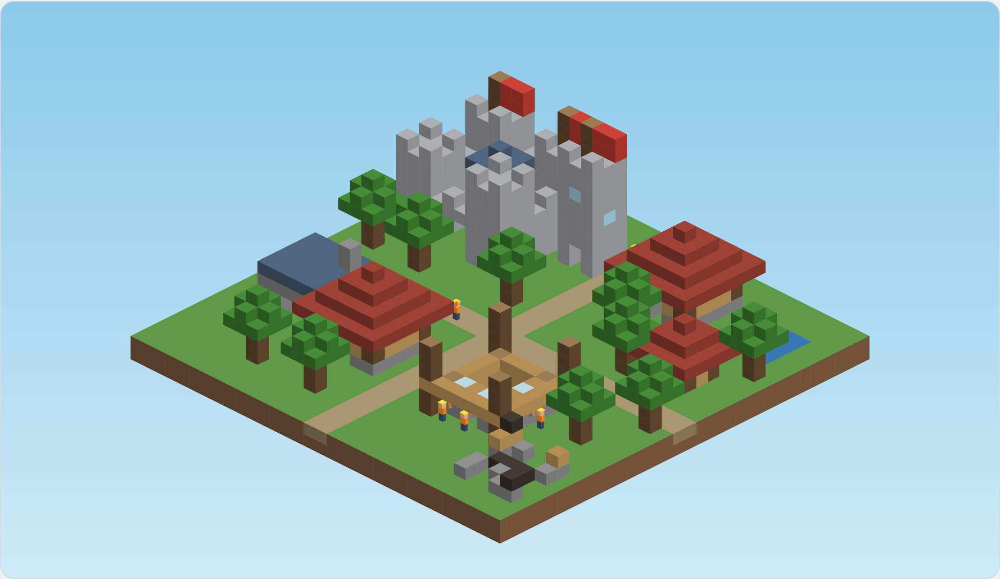
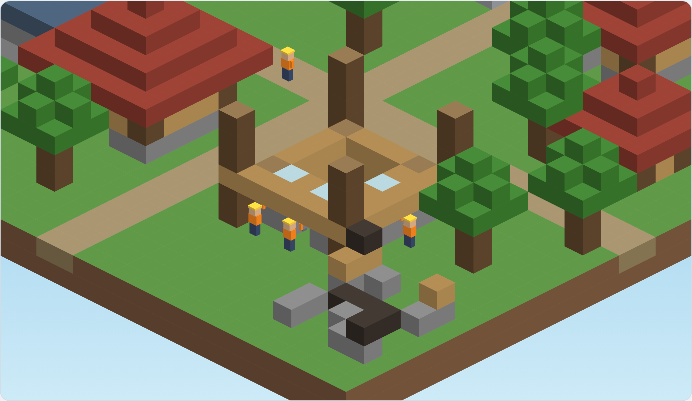

# Focus Town — Build Checklist

Companion to `prompt_plan.md`. Tick each box as you go. A step is done only when every box under it is checked, `flutter analyze` is clean, `flutter test` is green, and the app still launches on your iPhone.

## Visual reference

Build toward this look. Interactive prototype: https://claude.ai/artifact/Ee7RdRToJiXaa2hHeqs263

---

## 0. Before you start

### Accounts and costs
- [ ] Enroll in the Apple Developer Program ($99/year), needed for TestFlight
- [ ] Create a Google Play Console account ($25 one-time), needed before the Android beta
- [ ] Decide on bundle id / application id (e.g. `com.yourname.focustown`) and reserve the app name in App Store Connect

### Machine setup (MacBook Air)
- [x] Install or update Xcode and command-line tools
- [x] Install Flutter (stable channel) and run `flutter doctor` until it is clean
- [ ] Install Android Studio, an Android SDK (API 29+), and create an emulator
- [x] Install CocoaPods
- [ ] Enable Developer Mode on your iPhone and confirm `flutter devices` sees it
- [x] Set a passcode on your iPhone (required for lock detection)
- [ ] Get access to a physical Android phone (ideally Samsung or Xiaomi) before step 11

### Project hygiene
- [x] Create a private git repository
- [x] Add `prompt_plan.md`, `todo.md`, and the reference images to `docs/`
- [x] Save a copy of the prototype HTML (`focus-town-voxel.html`) in `docs/reference/` for steps 13–18
- [x] Set up a simple CI script (or a local `make check`) that runs `flutter analyze` and `flutter test`
- [ ] Agree on a commit format: `step NN: short description`

---

## Phase A: foundation and rules

### Step 1: project skeleton and clock
- [ ] Paste Prompt 0 + Prompt 1
- [x] Flutter app `focus_town` created (iOS 17+, Android minSdk 29)
- [x] Riverpod, lints, and mocktail added
- [x] Folders `lib/domain`, `lib/data`, `lib/platform`, `lib/game`, `lib/ui`, `lib/app` and matching `test/` folders exist
- [x] `Clock`, `SystemClock`, and `FakeClock` (advance, setWall, simulateReboot) implemented
- [x] Clock unit tests written first and passing
- [x] `clockProvider` added
- [x] `DebugScreen` shows wall time and uptime, refreshing every second
- [x] Widget test for `DebugScreen` passing
- [ ] App runs on iPhone
- [ ] Committed: `step 01`

### Step 2: building tiers
- [ ] Paste Prompt 0 + Prompt 2
- [x] `BuildingTier` enum with minutes, workers at risk, workers added
- [x] `forMinutes` rejects < 10, > 120, and non-multiples of 5
- [x] `validDurations` returns 23 values
- [x] `largestAffordable` implemented
- [x] Boundary tests (10, 20, 25, 40, 45, 60, 65, 90, 95, 120) passing
- [x] Duration slider on `DebugScreen` shows tier and workers at risk
- [ ] Committed: `step 02`

### Step 3: elapsed-time calculator
- [ ] Paste Prompt 0 + Prompt 3
- [x] `TimeStamp` (wall + uptime) implemented
- [x] `elapsedBetween` trusts uptime, falls back to wall after reboot, never negative
- [x] `wallClockTampered` implemented
- [x] Tests: normal, clock forward, clock backward, reboot, reboot with clock backward
- [x] "Elapsed since app start" shown on `DebugScreen`
- [ ] Committed: `step 03`

### Step 4: session state machine
- [ ] Paste Prompt 0 + Prompt 4
- [x] `Session` model and enums implemented
- [x] `SessionEngine`: start, onLocked, onCallStarted, onBackgroundedUnlocked, onForegrounded, abandon, resolve, progress
- [x] 10-second warning and one 60-second pass enforced
- [x] `resolve()` fails an away session past its limit without a foreground event
- [x] Tests: completion, lock, away 5s, away 30s (pass), second away fails, away 90s, resolve while away, exact completion, abandon, too few workers, progress, reboot during away
- [x] Session simulator panel on `DebugScreen` works with a local `FakeClock`
- [ ] Committed: `step 04`

### Step 5: town rules
- [ ] Paste Prompt 0 + Prompt 5
- [x] `TownState` and `TownBuilding` implemented; `TownState.initial()` = 3 workers, 6 plots, starter house
- [x] `nextFreePlot`, `applyCompleted`, `applyFailed`, `canStart`, `placeQueued` implemented
- [x] Ruins occupy a plot
- [x] Recovery mode enters at 0 workers, allows hut-only sessions, failure costs nothing, exits at 3 workers
- [x] `SessionEngine.start` uses recovery-aware worker availability
- [x] Tests for every rule listed in the prompt passing
- [x] Simulator shows workers, plots, queue, recovery flag, buildings; slider disables invalid durations
- [ ] Committed: `step 05`

### Step 6: daily streak, plots, and XP
- [ ] Paste Prompt 0 + Prompt 6
- [x] `LocalDate` value class implemented
- [x] XP = focus minutes on completion
- [x] Streak: same day unchanged, next day +1, gap resets to 1
- [x] One plot per focus day, then queue drains
- [x] `currentStreak` shows 0 after a missed day
- [x] `TownLevel` thresholds: Camp 0, Village 300, Town 1,500, City 6,000, Metropolis 15,000
- [x] Failed sessions change none of these
- [x] Tests incl. Jan 31 → Feb 1 and Dec 31 → Jan 1 passing
- [ ] "+1 day" button and streak/level display on simulator
- [ ] Committed: `step 06`

### Phase A review
- [ ] Domain test coverage at or above 90%
- [ ] `lib/domain` has no Flutter imports (`grep -r "package:flutter" lib/domain` returns nothing)
- [ ] Every functional rule FR-1 to FR-9 from the spec has at least one test

---

## Phase B: data and controller

### Step 7: database and repository
- [ ] Paste Prompt 0 + Prompt 7
- [ ] Drift, drift_dev, build_runner added; code generation runs
- [ ] Tables: towns, buildings, sessions (schema v1)
- [ ] `TownRepository`: loadOrCreate, activeSession, saveSessionStarted, saveSessionUpdated, saveSessionResolved
- [ ] Row/domain mappers in a separate file; domain stays Drift-free
- [ ] Resolved saves happen in one transaction
- [ ] Tests: seeding, full round-trip, active session, atomic failure, queued buildings
- [ ] "Stored town" card on `DebugScreen`
- [ ] Data survives an app restart on iPhone
- [ ] Committed: `step 07`

### Step 8: focus controller
- [ ] Paste Prompt 0 + Prompt 8
- [ ] `FocusController`, `FocusState`, `SessionResult` implemented
- [ ] `init()` resolves any active session from timestamps on launch
- [ ] start, lifecycle methods, tick, abandon, clearResult implemented
- [ ] Tests: completion persisted, 90s failure, 30s pass, kill-and-relaunch failure, kill-and-relaunch completion, no workers, recovery end-to-end
- [ ] `DebugScreen` simulator now uses the real controller and database
- [ ] 1-second tick timer while a session is active
- [ ] Result dialog shown and cleared
- [ ] Device check: start 10-min session, force-quit, reopen, outcome correct
- [ ] Committed: `step 08`

---

## Phase C: platform

### Step 9: lifecycle event stream and fallback
- [ ] Paste Prompt 0 + Prompt 9
- [ ] `LifecycleEvent` and `LifecycleSource` defined
- [ ] `FallbackLifecycleSource` maps paused → locked (lenient)
- [ ] `LifecycleRouter` maps events to controller calls
- [ ] Backgrounded-then-locked within 500 ms treated as lock (clock-driven, testable)
- [ ] Backgrounded during a call ignored
- [ ] `FakeLifecycleSource` for tests
- [ ] Router tests passing
- [ ] Event log panel on `DebugScreen` (last 20 events, source type)
- [ ] Committed: `step 09`

### Step 10: iOS native bridge
- [ ] Paste Prompt 0 + Prompt 10
- [ ] Swift `FocusLifecyclePlugin` registered in `AppDelegate`
- [ ] Event channel `focus/lifecycle/events` and method channel `focus/lifecycle` working
- [ ] Lock/unlock via protected-data notifications
- [ ] Background/foreground events
- [ ] Call detection via `CXCallObserver`
- [ ] Locked emitted before backgrounded on lock
- [ ] Native uptime (`systemUptime`) used for the clock on iOS
- [ ] `NativeLifecycleSource` parsing tests passing; malformed events ignored
- [ ] `docs/device_tests.md` created with iOS checklist
- [ ] Device: lock 1 min, no penalty
- [ ] Device: app switch triggers away path
- [ ] Device: phone call, no penalty
- [ ] Device: Control Center pull-down, no events
- [ ] Event log shows "native"
- [ ] Committed: `step 10`

### Step 11: Android native bridge
- [ ] Paste Prompt 0 + Prompt 11
- [ ] Kotlin `FocusLifecyclePlugin` registered in `MainActivity`
- [ ] Same channel names and event format as iOS
- [ ] onStop/onStart for background/foreground (not onPause)
- [ ] Screen off / user present broadcasts for lock/unlock
- [ ] Keyguard/interactive check emits locked before backgrounded
- [ ] Call state via `TelephonyCallback` (API 31+) / `PhoneStateListener` (API 29–30)
- [ ] READ_PHONE_STATE need documented for each API level
- [ ] `elapsedRealtime()` used for uptime
- [ ] Provider fallback test passing
- [ ] Device (Samsung/Xiaomi): screen off 1 min, no penalty
- [ ] Device: app switch triggers away path
- [ ] Device: notification shade pull-down does NOT background
- [ ] Device: phone call, no penalty
- [ ] Device: recent-apps screen and split screen behave as expected
- [ ] Device: OEM battery manager does not corrupt outcomes (kill the app from settings mid-session, reopen)
- [ ] Committed: `step 11`

### Step 12: notifications
- [ ] Paste Prompt 0 + Prompt 12
- [ ] flutter_local_notifications added and configured for iOS and Android
- [ ] Android channel `focus_warnings` (high importance)
- [ ] `Notifier` interface, `LocalNotifier`, `FakeNotifier`
- [ ] Immediate warning on leave; pass warning at +10s when a pass is available
- [ ] Warnings cancelled on return, lock, completion, failure, abandon
- [ ] Notifier errors caught and never affect session outcome
- [ ] Tests passing
- [ ] Permission button and status on `DebugScreen`
- [ ] Device: warning appears within 1 second of switching apps; second notification cancelled on return
- [ ] Committed: `step 12`

### Phase C review
- [ ] Full iOS device checklist in `docs/device_tests.md` passes
- [ ] Full Android device checklist passes
- [ ] Fallback source still works when native is disabled (temporarily force fallback and test)

---

## Phase D: block-town rendering

### Step 13: isometric math and voxel world
- [ ] Paste Prompt 0 + Prompt 13 (attach prototype HTML)
- [ ] `project` / `unproject` implemented
- [ ] `BlockMaterial` palette with precomputed texture variants
- [ ] `VoxelWorld` set/get/remove/fill/ring
- [ ] Visible-face culling (top, +x, +y)
- [ ] Depth sort (x + y + z, stable tie-break)
- [ ] Tests passing
- [ ] "World stats" line on `DebugScreen`
- [ ] Committed: `step 13`

### Step 14: building definitions and town layout
- [ ] Paste Prompt 0 + Prompt 14
- [ ] Plot layout: at least 40 deterministic plots around crossing roads, 0–5 nearest the center
- [ ] Hut, house, workshop, tower, castle defined with construction stages
- [ ] Castle shrunk to fit a 7x7 plot (documented)
- [ ] Ruin, tree, and scenery builders; scenery deterministic from a seed
- [ ] `maxStage` and `stageForProgress`
- [ ] `buildTownWorld` from real `TownState`, incl. active site and full-plots case
- [ ] Tests: footprints, non-decreasing stages, plot placement, ruins, deterministic scenery, no overlaps
- [ ] `DebugScreen` world stats use real town data
- [ ] Committed: `step 14`

### Step 15: Flame renderer with cached static layer
- [ ] Paste Prompt 0 + Prompt 15
- [ ] Flame added
- [ ] `TownGame` draws textured faces (plain when tile < 9 px)
- [ ] Static town cached to a picture/image; re-recorded only on town or zoom change
- [ ] Viewport culling during recording
- [ ] Sky gradient
- [ ] `HomeScreen` with `GameWidget` is now the app's home
- [ ] `DebugScreen` reachable via long-press (debug builds only)
- [ ] Golden tests for initial and 5-building towns
- [ ] Cache re-record spy test passing
- [ ] Device: real town visible, smooth scrolling
- [ ] Visual check against the reference images above
- [ ] Committed: `step 15`

### Step 16: camera pan and zoom
- [ ] Paste Prompt 0 + Prompt 16
- [ ] `TownCamera`: fitToTown, panBy, zoomAt, clamps, focusOn
- [ ] Drag, pinch, wheel, and double-tap gestures
- [ ] Animated focus on the active site when a session starts
- [ ] Recenter button on `HomeScreen`
- [ ] Camera tests passing
- [ ] Device: pan, pinch, and double-tap feel right; can zoom close enough to see one worker
- [ ] Committed: `step 16`

### Step 17: workers and frame cap
- [ ] Paste Prompt 0 + Prompt 17
- [ ] Worker box model about 1.6 blocks tall, matching the close-up reference
- [ ] Poses: idle, hammerUp, hammerDown, walk1, walk2, dead
- [ ] Site workers = assigned workers; up to 4 spare workers walk the roads
- [ ] Local occlusion redraw for workers near buildings (documented)
- [ ] `FrameLimiter`: 15 fps normal, 10 fps low power, 0 when hidden/locked
- [ ] Low-power mode read through the platform channel on both OSes
- [ ] Reduced motion keeps workers idle
- [ ] Tests passing
- [ ] fps shown on `DebugScreen`
- [ ] Profiler: about 15 fps in use, near-zero GPU when locked
- [ ] Committed: `step 17`

### Step 18: live construction
- [ ] Paste Prompt 0 + Prompt 18
- [ ] Active site on its own dynamic layer with scaffolding until the last stage
- [ ] Dynamic layer re-recorded only on stage change
- [ ] Completion: scaffolding removed, 1-second celebration, building merged into static town
- [ ] Failure: dead workers, ruin, 3-second smoke
- [ ] Queued: floating outline with "ready to place" label
- [ ] Progress computed live from `SessionEngine.progress`
- [ ] Tests and goldens (house stage 4, failure state) passing
- [ ] Device: a 10-minute session visibly builds a hut
- [ ] Committed: `step 18`

### Phase D review
- [ ] Battery: under 5% per hour with screen on (iPhone 12 or newer), measured
- [ ] Town looks like the reference images and prototype
- [ ] No visible depth-order glitches at common zoom levels

---

## Phase E: screens and release

### Step 19: session setup screen
- [ ] Paste Prompt 0 + Prompt 19
- [ ] "Start focus" button on `HomeScreen` when idle
- [ ] Bottom sheet with 5-minute-step picker, default 25 min, remembers last value
- [ ] Schema v2 migration (lastDurationMinutes) with test
- [ ] Live preview: tier, block icon, workers at risk, workers gained
- [ ] Unaffordable durations disabled with a reason
- [ ] Recovery mode: hut-only with Last Builder banner
- [ ] Widget tests passing
- [ ] Device: session started from home screen without debug tools
- [ ] Committed: `step 19`

### Step 20: HUD and result screens
- [ ] Paste Prompt 0 + Prompt 20
- [ ] HUD: streak, level + progress bar, workers, plots, queue badge
- [ ] Session overlay: countdown, tier, progress, lock-your-phone hint (first 3 sessions)
- [ ] Abandon with confirmation dialog
- [ ] Result dialogs: completed, queued, failed, recovery started, recovery ended, level up, plot unlocked
- [ ] Copy in plain language, active voice, no emoji
- [ ] Redundant debug buttons removed (simulators kept)
- [ ] Widget tests for every HUD state and dialog
- [ ] Device: full loop works with no debug screen
- [ ] Committed: `step 20`

### Step 21: onboarding
- [ ] Paste Prompt 0 + Prompt 21
- [ ] Three onboarding pages with live town renders
- [ ] Notification permission requested on page 3 with explanation
- [ ] Android phone-state permission requested if needed (continue if denied)
- [ ] Start begins a 10-minute hut session and marks onboarding done
- [ ] One-time tips: first leave, first worker growth, first recovery
- [ ] Schema v3 migration (tip flags) with test
- [ ] Denied-notifications note shown once
- [ ] Tests passing
- [ ] Device: fresh install → running session in under 30 seconds
- [ ] Committed: `step 21`

### Step 22: error handling, debug tools, and release
- [ ] Paste Prompt 0 + Prompt 22
- [ ] DB write retry and user message
- [ ] Pre-migration backup and restore; fresh-town fallback with message
- [ ] Native bridge failure falls back to lenient source
- [ ] Render failure / low fps falls back to static image
- [ ] Clock tampering logged
- [ ] Local log ring buffer (200 lines) persisted
- [ ] Hidden debug screen in release (7-tap) with log export and beta stats
- [ ] Accessibility: labels on buttons and HUD, Dynamic Type, town summary for screen readers, reduced motion
- [ ] App icon (block house) and splash screen
- [ ] Bundle id, version, and build number set
- [ ] iOS release signing configured
- [ ] Android release keystore created and backed up safely (not in git)
- [ ] iOS `PrivacyInfo.xcprivacy` declares no tracking and no data collected
- [ ] Final integration test (full flow with fast fake clock) passing
- [ ] Committed: `step 22`

---

## Final verification

### Manual device checklist (both iPhone and Android)
- [ ] 10-min session, lock 5 min, unlock: continues
- [ ] Switch app, return in 5s: no penalty
- [ ] Switch away 30s: pass spent, continues
- [ ] Switch away 90s: workers die, ruin appears
- [ ] Phone call mid-session: no penalty, no pass used
- [ ] Control Center / notification shade: no penalty
- [ ] Force-quit mid-session, reopen: outcome correct
- [ ] Reboot mid-session: treated as away, resolved on launch
- [ ] Device time moved forward 2 hours: session does not complete early
- [ ] Notifications denied: one-time note, rules still apply
- [ ] Sessions on 2 different days: streak 2, plots 8
- [ ] All plots full: building queued, placed when next plot unlocks
- [ ] Lose all workers: recovery mode; 3 huts later it ends
- [ ] Low Power Mode / Battery Saver: lower fps, no particle effects
- [ ] VoiceOver / TalkBack can start a session and read the HUD
- [ ] Airplane mode: everything still works

### Quality gates
- [ ] `flutter analyze` clean
- [ ] All unit, widget, golden, and integration tests green
- [ ] Domain coverage at or above 90%
- [ ] No orphaned code (every class used; search for unused files)
- [ ] No network calls anywhere (search for `http`, `dio`, analytics SDKs)

---

## Beta and launch

### TestFlight beta
- [ ] App Store Connect listing created (name, subtitle, description, keywords)
- [ ] Screenshots taken from the real app (block town, construction, ruin)
- [ ] Privacy nutrition label: data not collected
- [ ] Upload build to TestFlight
- [ ] Recruit 15–30 testers
- [ ] Share a short tester guide: how to play, how to send debug stats
- [ ] Run beta for 2 weeks

### Android closed testing
- [ ] Play Console listing and data-safety form (no data collected)
- [ ] Upload release bundle (AAB) to closed testing
- [ ] Add testers

### Beta measurement
- [ ] Collect debug stats from testers (sessions started, completed, failed, days active)
- [ ] Day-7 retention calculated
- [ ] Completion rate calculated
- [ ] Bugs triaged; any data-loss bug fixed before launch

### Launch decision
- [ ] Day-7 retention at or above 20%
- [ ] Completion rate at or above 70%
- [ ] Zero open data-loss bugs
- [ ] If all met: submit for public release
- [ ] If not met: review feedback and adjust the core mechanic before adding v2 features

---

## After launch (v2 backlog, do not start before launch criteria are met)
- [ ] Coins economy and coin packs
- [ ] Famous buildings (multi-session) with damage on failure
- [ ] Cleanup sessions for ruins
- [ ] Earned passes
- [ ] Tents / soft housing cap
- [ ] Lock-screen progress (Live Activity / Android ongoing notification)
- [ ] Daily reminders and inactivity nudges
- [ ] Building plaques
- [ ] Cloud backup
- [ ] Achievements and daily quests
